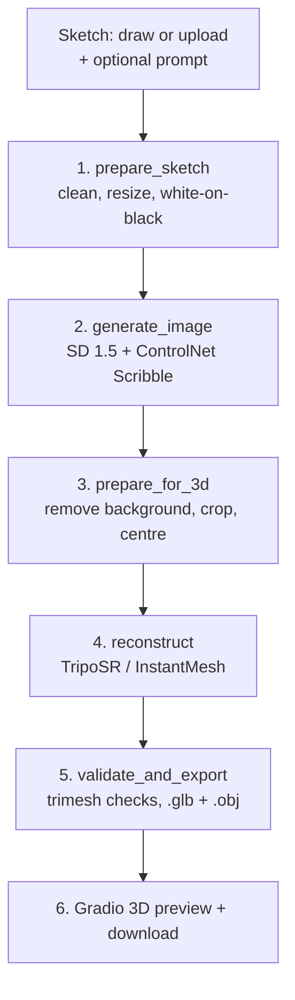
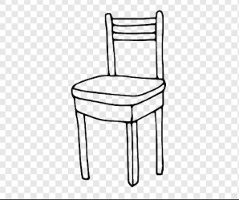
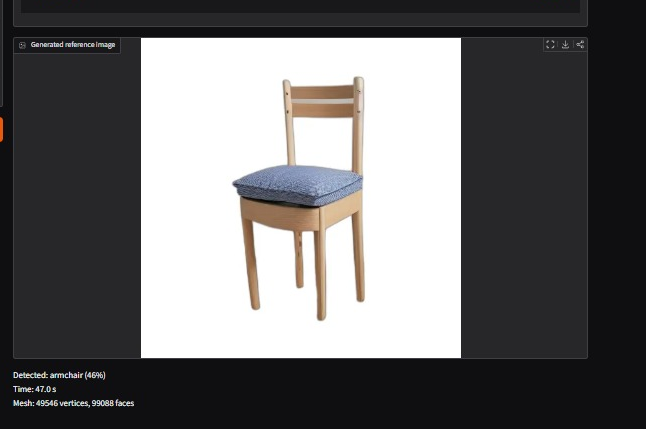
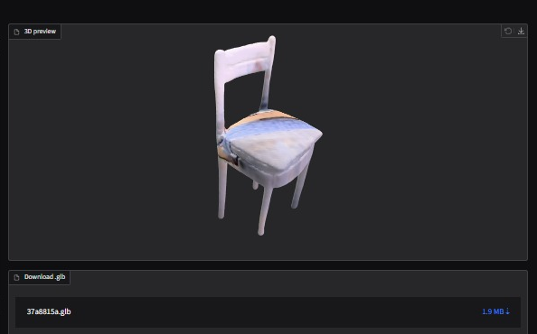

# 🎨 Sketch2Shape AI

**Turn a hand-drawn 2D sketch into a coloured 3D model, in your browser.**

Draw or upload a sketch, add an optional text prompt, and get an interactive 3D preview plus a downloadable `.glb` / `.obj` file.

[Overview](#-overview) · [How it works](#-how-it-works) · [Quick start](#-quick-start) · [Project structure](#-project-structure) · [Results](#-sample-results) · [Limitations](#-limitations) · [Troubleshooting](#-troubleshooting) · [Team](#-team)

---

## 📌 Overview

Traditional 3D modelling needs specialist software and a lot of time. Sketch2Shape AI lets anyone who can draw an object create a 3D version of it with almost no manual work.

**Features**

| | Feature | Description |
|---|---|---|
| ✏️ | Sketch canvas | Draw directly in the app (brush, eraser, reset) |
| 📤 | Image upload | Use an existing sketch or drawing |
| 💬 | Optional prompt | Guides the result; never required |
| 🖼️ | AI image generation | Stable Diffusion 1.5 + ControlNet Scribble makes a clean product-style image |
| ✂️ | Auto preprocessing | Background removal, cropping and centring |
| 🧊 | 3D reconstruction | Image-to-3D with colours (TripoSR; InstantMesh optional) |
| 👀 | Interactive preview | Rotate and zoom in the browser |
| ⬇️ | Download | `.glb` for viewing, `.obj` for other tools |

---

## ⚙️ How it works



| Stage | Function | Owner | Input → Output |
|---|---|---|---|
| 1 | `prepare_sketch()` |  Sketch → white-on-black 512×512 RGB |
| 2 | `generate_image()` |  Sketch + optional prompt → product image |
| 3 | `prepare_for_3d()` |  Image → **RGBA**, transparent background, object centred |
| 4 | `reconstruct()` |  RGBA image → `trimesh.Trimesh` with colours |
| 5 | `validate_and_export()` |  Mesh → `.glb` + `.obj` paths |
| 6 | `run_pipeline()` |  Chains everything; powers the UI |

### Shared function contract

```python
# src/sketch_to_image.py   (P1)
def generate_image(sketch: Image.Image, prompt: str | None = None) -> Image.Image

# src/preprocess.py        (P2)
def prepare_sketch(img: Image.Image) -> Image.Image     # white strokes on black, 512x512 RGB
def prepare_for_3d(img: Image.Image) -> Image.Image     # RGBA, background fully transparent

# src/reconstruct.py       (P3)
def reconstruct(img: Image.Image) -> trimesh.Trimesh    # needs RGBA input

# src/export.py            (P2)
def validate_and_export(mesh, out_dir: str, name: str) -> dict
# returns {"glb": path, "obj": path, "vertices": int, "faces": int, "extents": [x, y, z]}

# src/pipeline.py          (P4)
def run_pipeline(sketch, prompt=None) -> dict
```

> **Prompt is optional.** With no prompt, the generator uses a neutral default such as *"a product render, white background"*.

---

## 🚀 Quick start

### Requirements

- Python 3.10+ and Git
- An NVIDIA GPU with CUDA is strongly recommended (TripoSR needs roughly 6–8 GB VRAM; InstantMesh needs more)
- No GPU? Run on Kaggle or Colab, or set `MOCK_MODE = True` in `config.py` to test the UI with dummy outputs

### Installation

Follow the steps in order. Each step is a separate block, so you can copy and run them one at a time.

#### Step 1: Clone the repository

```bash
git clone YOUR_GITHUB_REPOSITORY_URL
cd sketch2shape
```

#### Step 2: Create a virtual environment

```bash
python -m venv venv
```

#### Step 3: Activate the environment

**Windows**
```bash
venv\Scripts\activate
```

**Linux / macOS**
```bash
source venv/bin/activate
```

You should now see `(venv)` at the start of your terminal line.

#### Step 4: Install PyTorch

Pick the command for your machine from [pytorch.org](https://pytorch.org/get-started/locally/). Choosing the build that matches your CUDA version avoids most install problems.

```bash
# Example for NVIDIA GPU (CUDA 12.1)
pip install torch torchvision --index-url https://download.pytorch.org/whl/cu121
```

#### Step 5: Install project dependencies

```bash
pip install -r requirements.txt
```

#### Step 6: Install the 3D reconstruction model (TripoSR)

```bash
git clone https://github.com/VAST-AI-Research/TripoSR third_party/TripoSR
pip install -r third_party/TripoSR/requirements.txt
```

> `torchmcubes` is the package most likely to fail here. It must be built against the same PyTorch version you installed in Step 4.

#### Step 7: Check the installation (optional)

```bash
python -m scripts.test_preprocess
python -m scripts.test_export
```

> Model weights (Stable Diffusion, ControlNet, TripoSR) download automatically the first time you run the app, so the first run needs internet and takes longer.

### Run

```bash
python app.py
```

Open the local URL printed in the terminal, then:

1. Draw a sketch or upload an image.
2. *(Optional)* describe the object in the prompt box.
3. Click **Generate** and wait for the pipeline to finish.
4. Rotate the 3D preview and download your model.

---

## 📁 Project structure

```text
sketch2shape/
├── app.py                    # Gradio UI
├── config.py                 # DEVICE, LOW_VRAM, MOCK_MODE, paths
├── requirements.txt
├── README.md
│
├── src/
│   ├── __init__.py
│   ├── pipeline.py           # chains all stages
│   ├── sketch_to_image.py    # SD 1.5 + ControlNet
│   ├── preprocess.py         # prepare_sketch, prepare_for_3d
│   ├── reconstruct.py        # image -> 3D mesh
│   └── export.py             # validate_and_export
│
├── scripts/                  # standalone test scripts per module
├── third_party/              # cloned TripoSR / InstantMesh (not committed)
├── weights/                  # model weights cache (not committed)
├── outputs/                  # generated results (not committed)
├── samples/
│   ├── sketches/             # test inputs
│   └── outputs/              # example results
├── notebooks/                # Kaggle / Colab runner
└── docs/                     # architecture, benchmarks, AI disclosure, licences
```

---

## 🧰 Technology stack

| Area | Tool | Purpose |
|---|---|---|
| UI | Gradio | Canvas, upload, prompt, 3D preview |
| Image generation | Stable Diffusion 1.5 + ControlNet Scribble (Diffusers) | Clean image that keeps the sketch's shape |
| Preprocessing | rembg, OpenCV, Pillow | Background removal, denoising, centring |
| 3D reconstruction | TripoSR (default), InstantMesh (optional upgrade) | Image to 3D mesh |
| Mesh handling | Trimesh | Validation and export |
| Deep learning | PyTorch | Runs the models |

---

## 🖼️ Sample results

| Input sketch | Generated image | 3D model |
|---|---|---|
|  |  |  |

> Replace these with real screenshots. Add timings and VRAM figures only after testing (see `docs/benchmarks.md`).

**Output formats**

| Format | Use |
|---|---|
| `.glb` | Preview in the app and most 3D viewers |
| `.obj` | Import into Blender, MeshLab and other tools |

---

## ⚠️ Limitations

- Complex, unclear or very incomplete sketches can give inaccurate or failed models.
- The 3D shape is predicted from a single view, so the back and fine details are guesses.
- Colours and textures may differ from what you expect.
- Quality depends on the generated image; a poor image gives a poor mesh.
- Speed and memory use depend heavily on your GPU.
- InstantMesh needs much more GPU memory than TripoSR.

---

## 🛠️ Troubleshooting

<details>
<summary><b>CUDA out of memory</b></summary>

Lower `TSR_MC_RESOLUTION` (e.g. 128) and `TSR_CHUNK_SIZE` (e.g. 4096) in `config.py`, enable `LOW_VRAM`, or use Kaggle/Colab.
</details>

<details>
<summary><b>PyTorch or torchmcubes install fails</b></summary>

Install a PyTorch build that matches your Python and CUDA versions first, then install TripoSR's requirements. `torchmcubes` must be built against that same PyTorch version.
</details>

<details>
<summary><b>"The canvas looks blank" / "drawing is too small"</b></summary>

Draw a clearer, larger shape with visible lines that fills more of the canvas.
</details>

<details>
<summary><b>"No object could be detected"</b></summary>

Use an image with the object on a plain background, or try a different sketch.
</details>

<details>
<summary><b>Background removal fails</b></summary>

Check that `rembg` and `onnxruntime` are installed. The first run downloads a model, so internet access is needed once.
</details>

<details>
<summary><b>Empty or flat mesh / export error</b></summary>

The reconstruction failed. Try a simpler, clearer image or a different seed.
</details>

<details>
<summary><b>Model loading error from Hugging Face</b></summary>

Check your internet connection and the model name, then retry.
</details>

<details>
<summary><b>App won't start</b></summary>

Activate the virtual environment and re-run `pip install -r requirements.txt`.
</details>

---

## 🔭 Future scope

- Better reconstruction accuracy and textures
- More sketch styles and object categories
- More image-to-3D models and export formats
- Lower GPU memory use and faster generation
- Basic in-app 3D editing

---

## 📚 Models and attribution

| Component | Source |
|---|---|
| Stable Diffusion 1.5 | https://huggingface.co/runwayml/stable-diffusion-v1-5 |
| ControlNet | https://github.com/lllyasviel/ControlNet |
| TripoSR | https://github.com/VAST-AI-Research/TripoSR |
| InstantMesh | https://github.com/TencentARC/InstantMesh |
| Diffusers | https://github.com/huggingface/diffusers |
| rembg | https://github.com/danielgatis/rembg |
| Trimesh | https://trimesh.org/ |
| Gradio | https://www.gradio.app/ |
| PyTorch | https://pytorch.org/ |
| OpenCV | https://opencv.org/ |

No external training dataset was used: the app takes user-provided sketches. Third-party models and weights keep their own licences; see `docs/models_and_licenses.md`.

---

## 👥 Team

| Member | Module | Contribution |
|---|---|---|
| [Tanmay singh] | Sketch-to-Image | Stable Diffusion + ControlNet, prompt handling |
| [Rupesh kumar kashyap] |  Preprocessing & Export | Sketch/image preprocessing, mesh validation, export |
| [Shashank bhoi] |  3D Reconstruction | TripoSR / InstantMesh integration |
| [Kunal Gour] |  Integration & UI | Pipeline, Gradio app, documentation |


---

<p align="center"><b>Sketch2Shape AI</b> · From a simple sketch to a 3D reality 🚀</p>
